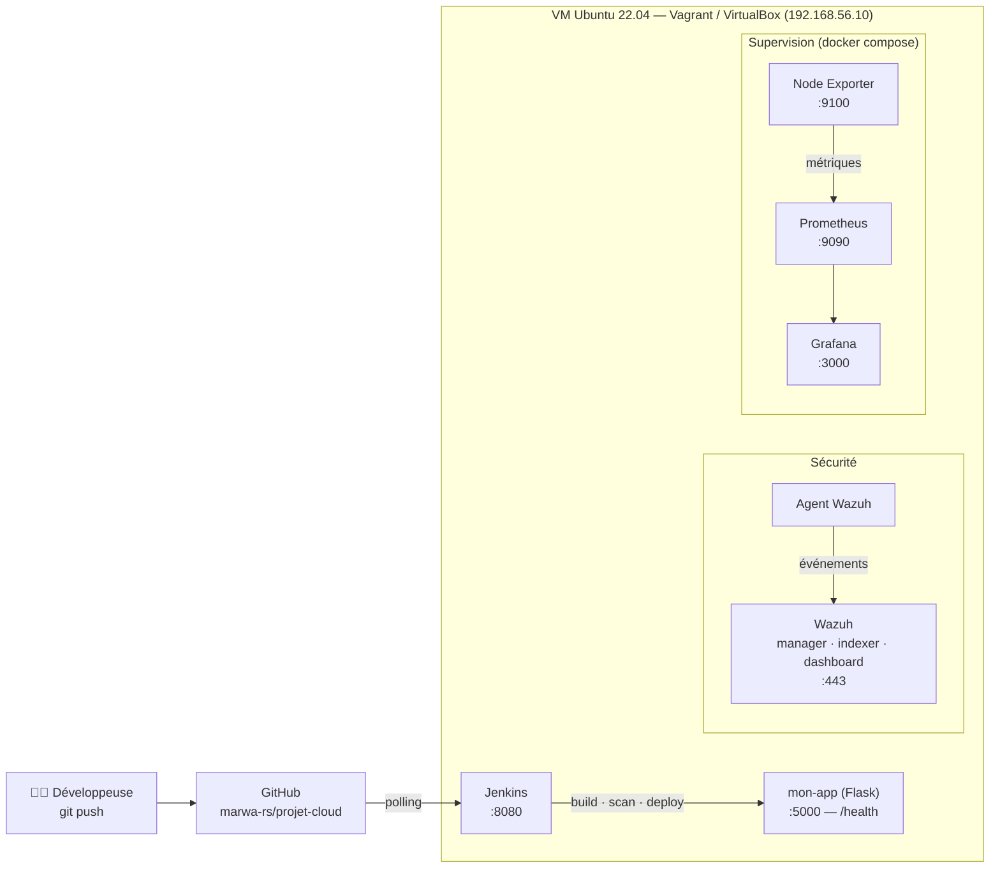
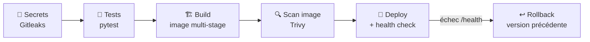
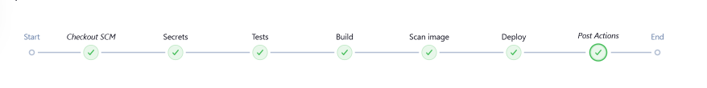
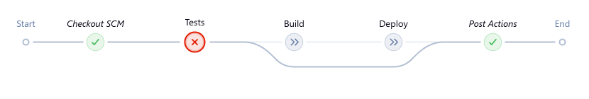
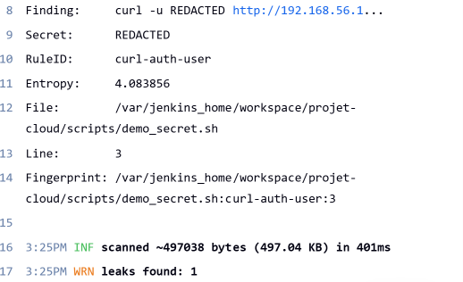
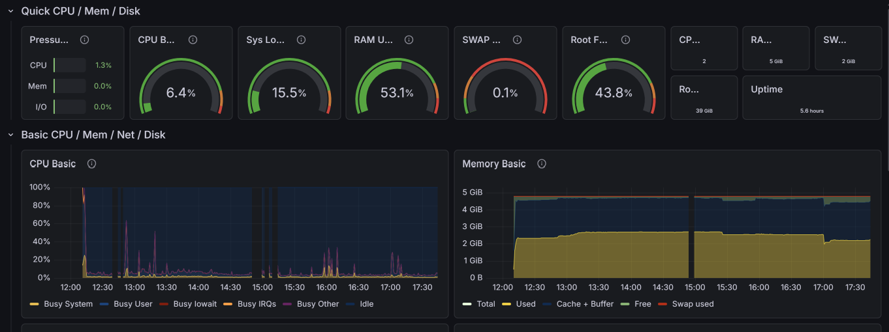
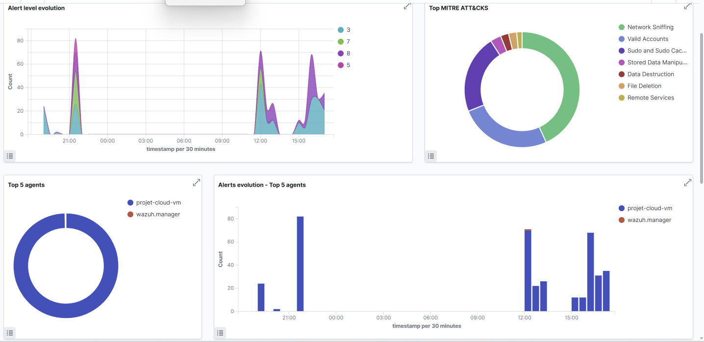

# Plateforme Cloud Sécurisée — DevSecOps & Supervision

> Infrastructure DevSecOps complète, construite et sécurisée de bout en bout : pipeline CI/CD Jenkins avec contrôles de sécurité automatiques, applications conteneurisées, détection d'intrusion (Wazuh) et supervision en temps réel (Prometheus / Grafana) — le tout décrit en code.


---

## Sommaire

- [Ce que fait le projet](#ce-que-fait-le-projet)
- [Architecture](#architecture)
- [Le pipeline DevSecOps](#le-pipeline-devsecops)
- [Résultats et démonstrations](#résultats-et-démonstrations)
- [Choix techniques et sécurité](#choix-techniques-et-sécurité)
- [Stack technique](#stack-technique)
- [Structure du dépôt](#structure-du-dépôt)
- [Lancer le projet](#lancer-le-projet)
- [Limites connues et suite](#limites-connues-et-suite)

---

## Ce que fait le projet

À chaque `git push`, un pipeline Jenkins :

1. **cherche des secrets** (mots de passe, clés, tokens) dans le code avec **Gitleaks** ;
2. **lance les tests automatiques** (pytest) à l'intérieur du build Docker ;
3. **construit une image Docker** multi-stage, exécutée sans les droits root ;
4. **scanne l'image** à la recherche de vulnérabilités connues (CVE) avec **Trivy** ;
5. **déploie** l'application, **vérifie qu'elle répond** (`/health`) et **revient automatiquement à la version précédente** en cas d'échec.

Si un seul contrôle échoue, **rien n'est déployé** : la version stable reste en production.

En parallèle, **Wazuh** surveille la machine (tentatives d'intrusion, logs suspects) et **Prometheus + Grafana** affichent l'état du système en temps réel.

---

## Architecture



| Service | Port | Rôle |
|---|---|---|
| Jenkins | 8080 | Orchestration CI/CD |
| mon-app | 5000 | Application Flask (page vitrine + `/health`) |
| Wazuh dashboard | 443 | SIEM / détection d'intrusion |
| Grafana | 3000 | Tableaux de bord (provisionnés automatiquement) |
| Prometheus | 9090 | Collecte des métriques |
| Node Exporter | 9100 | Métriques système de la VM |

---

## Le pipeline DevSecOps



| Étape | Outil | Bloque si… | Détail |
|---|---|---|---|
| **Secrets** | Gitleaks | un secret est trouvé dans le code | Scan des fichiers du commit (`gitleaks dir`), secrets masqués dans les logs (`--redact`) |
| **Tests** | pytest | un test échoue | Exécutés dans l'étape `test` du Dockerfile ; image de base rafraîchie à chaque build (`--pull`) |
| **Build** | Docker | — | Image finale sans outils de test ni pip, utilisateur non-root, `HEALTHCHECK` intégré, image versionnée par numéro de build |
| **Scan image** | Trivy | une faille HIGH/CRITICAL **corrigeable** existe | Image exportée (`docker save`) et scannée sans accès au socket Docker |
| **Deploy** | Docker + curl | l'application ne répond pas sur `/health` | 10 essais ; sinon **rollback automatique** vers l'image précédente et build en échec |

Le pipeline complet est défini dans [`jenkins/Jenkinsfile`](jenkins/Jenkinsfile).

---

## Résultats et démonstrations

### Pipeline complet



### Démo 1 — un bug est bloqué par les tests

Un bug volontaire (`/health` renvoyant `ko`) a été poussé : l'étape **Tests** échoue, **Build et Deploy sont sautés**, et la version précédente reste en ligne. Le bug a ensuite été annulé proprement avec `git revert`.



### Démo 2 — un secret est bloqué par Gitleaks

Un faux mot de passe écrit en dur dans un script a été poussé : l'étape **Secrets** échoue immédiatement (règle `curl-auth-user`), le secret est masqué dans les logs, et rien n'est construit ni déployé.



### Réduction des vulnérabilités de l'image (Trivy)

| Image | HIGH + CRITICAL | dont CRITICAL | dont corrigeables |
|---|---:|---:|---:|
| Image de base d'avril 2026 (Debian 13.4) | 113 | 6 | presque toutes |
| + reconstruction avec base à jour (`--pull`, Debian 13.7) | 46 | **0** | 2 |
| + retrait de pip / setuptools / wheel de l'image finale | **44** | **0** | **0** |

Les vulnérabilités restantes n'ont, à ce jour, **aucun correctif publié** par Debian. La règle du pipeline bloque automatiquement dès qu'un correctif devient disponible.

### Supervision

| Grafana — Node Exporter Full | Wazuh — alertes classées MITRE ATT&CK |
|---|---|
|  |  |

---

## Choix techniques et sécurité

**Gestion des secrets**
- Aucun secret dans le dépôt : mots de passe dans des fichiers `.env` locaux (ignorés par Git), modèles publics `.env.example`.
- Docker Compose refuse de démarrer si une variable obligatoire manque (`${VAR:?message}`) — pas de repli silencieux sur un mot de passe par défaut.
- `.gitignore`, `.dockerignore` et `.gitattributes` (fins de ligne LF) pour éviter les fuites vers Git et vers les images.

**Chaîne d'approvisionnement (supply chain)**
- Outils de sécurité en **version figée** ; Trivy **épinglé par digest** (`@sha256:…`), suite à la compromission d'images Trivy en mars 2026 (CVE-2026-33634) : une image modifiée serait refusée.
- Délai de carence volontaire avant d'adopter une version tout juste publiée.
- Dépendances Python figées (`requirements.txt`).

**Image Docker**
- Build **multi-stage** : les tests tournent dans une étape jetable ; l'image finale ne contient ni pytest ni les tests.
- Exécution avec un utilisateur **non-root** (`appuser`), `HEALTHCHECK` sur `/health`.
- Surface d'attaque minimale : pip, setuptools et wheel retirés de l'image finale.

**Moindre privilège**
- Les scanners reçoivent **uniquement** le volume du workspace, **en lecture seule** — pas le socket Docker.
- Socket Docker en permissions par défaut (`660 root:docker`) ; Jenkins y accède via le groupe `docker` (`group_add`) au lieu d'un `chmod 666` global.

**Fiabilité**
- `--restart unless-stopped` sur tous les services ; health check post-déploiement et rollback automatique.
- Supervision **as code** : sources de données et dashboards Grafana provisionnés depuis le dépôt.

---

## Stack technique

| Domaine | Outils |
|---|---|
| Virtualisation | Vagrant, VirtualBox, Ubuntu 22.04 |
| CI/CD | Jenkins (pipeline déclaratif), GitHub |
| Conteneurs | Docker (multi-stage), Docker Compose v2 |
| Sécurité du pipeline | Gitleaks, Trivy, pytest |
| Sécurité de l'infrastructure | Wazuh (SIEM / IDS) |
| Supervision | Prometheus, Node Exporter, Grafana |
| Application | Python 3.11, Flask |

---

## Structure du dépôt

```
projet-cloud/
├── Vagrantfile                    # VM Ubuntu (Docker, DNS, swap)
├── app.py                         # Application Flask (/ et /health)
├── requirements.txt               # Dépendances figées
├── requirements-dev.txt           # Dépendances de test
├── tests/test_app.py              # Tests pytest
├── Dockerfile                     # Image multi-stage (base / test / final)
├── jenkins/
│   ├── Jenkinsfile                # Pipeline DevSecOps
│   ├── docker-compose.yml         # Jenkins as code
│   └── .env.example
├── monitoring/
│   ├── docker-compose.yml         # Prometheus, Node Exporter, Grafana
│   ├── .env.example
│   ├── prometheus/prometheus.yml
│   └── grafana/provisioning/      # Datasource + dashboard provisionnés
├── wazuh/                         # Wazuh single-node (voir limites)
└── screenshots/
```

---

## Lancer le projet

Prérequis : VirtualBox, Vagrant, Git.

```bash
# 1. Créer la VM
git clone https://github.com/marwa-rs/projet-cloud.git
cd projet-cloud
vagrant up
vagrant ssh

# 2. Supervision
cd /vagrant/monitoring
cp .env.example .env            # puis définir un mot de passe Grafana solide
docker compose up -d

# 3. Jenkins
cd /vagrant/jenkins
echo "DOCKER_GID=$(getent group docker | cut -d: -f3)" > .env
docker volume create jenkins_home
docker compose up -d
```

Puis créer dans Jenkins un job *Pipeline from SCM* pointant vers ce dépôt (`jenkins/Jenkinsfile`).

| Interface | URL |
|---|---|
| Application | http://192.168.56.10:5000 |
| Jenkins | http://192.168.56.10:8080 |
| Grafana | http://192.168.56.10:3000 |
| Prometheus | http://192.168.56.10:9090 |
| Wazuh | https://192.168.56.10 |

---

## Limites connues et suite

Limites assumées :
- Jenkins conserve un accès privilégié à Docker via le socket (inhérent à « Jenkins pilote Docker ») ; une isolation complète demanderait Docker *rootless* ou des agents de build dédiés.
- La configuration Wazuh n'est pas encore versionnée dans ce dépôt (sous-module), et ses mots de passe par défaut restent à changer.
- Jenkins détecte les commits par *polling* (VM sur réseau privé, donc pas de webhook GitHub possible).
- Le `Vagrantfile` mis à jour n'a pas encore été revalidé par une recréation complète de la VM.

Prochaines étapes :
- [ ] Déploiement sur **AWS** (EC2, VPC, Security Groups) avec **Terraform**
- [ ] Webhook GitHub (possible avec une IP publique)
- [ ] Alertes Wazuh dans Grafana
- [ ] Hook *pre-commit* Gitleaks sur le poste de développement

---

**Auteure :** Marwa Rsaim — élève ingénieure en Réseaux, Systèmes et Services Programmables, ENSA Marrakech.
