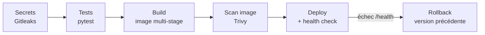
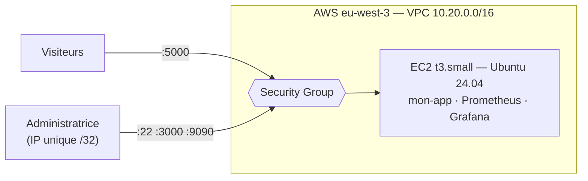
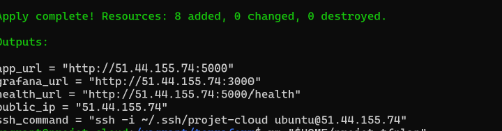
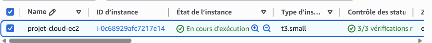
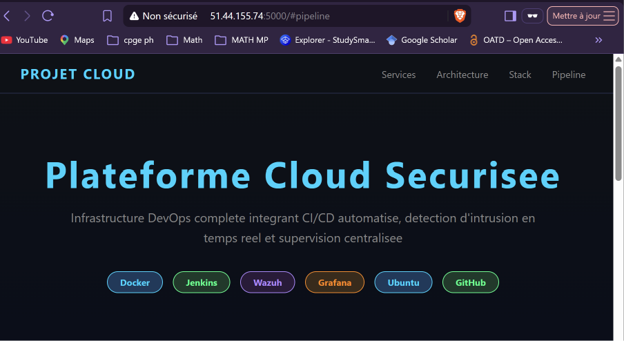
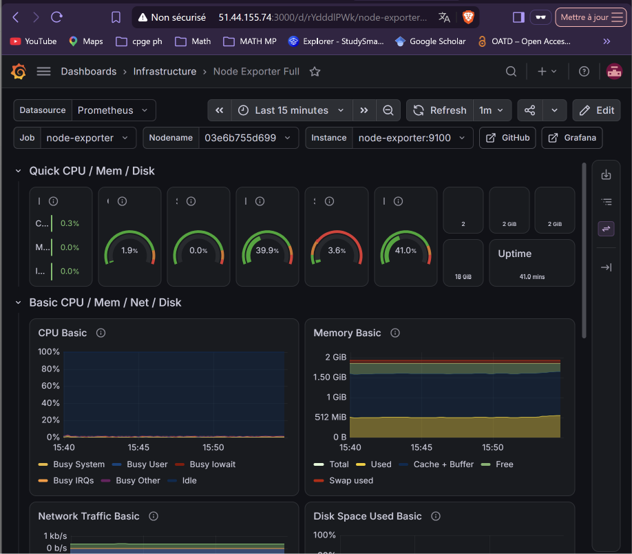

# Plateforme Cloud Sécurisée — DevSecOps & Supervision

Pipeline CI/CD Jenkins avec contrôles de sécurité automatiques, application conteneurisée, détection d'intrusion (Wazuh), supervision (Prometheus / Grafana) et déploiement sur **AWS avec Terraform** — le tout décrit en code.


---

## Le pipeline DevSecOps

À chaque `git push`, Jenkins exécute les étapes suivantes. Si un contrôle échoue, **rien n'est déployé**.



| Étape | Outil | Bloque si… |
|---|---|---|
| Secrets | Gitleaks | un mot de passe, une clé ou un token est trouvé dans le code |
| Tests | pytest | un test échoue |
| Build | Docker | — (image non-root, sans pip, avec `HEALTHCHECK`) |
| Scan image | Trivy | une faille HIGH/CRITICAL **corrigeable** existe |
| Deploy | Docker + curl | l'app ne répond pas sur `/health` → **rollback automatique** |


### Démonstrations

| Un bug est bloqué par les tests | Un secret est bloqué par Gitleaks |
|---|---|
|  |  |

**Vulnérabilités de l'image (Trivy)** : 113 failles HIGH/CRITICAL au départ → **44, dont 0 critique et 0 corrigeable** après mise à jour de l'image de base et retrait de pip / setuptools / wheel.

---

## Supervision et détection d'intrusion

| Grafana — métriques système | Wazuh — alertes classées MITRE ATT&CK |
|---|---|
|  |  |

Prometheus collecte les métriques (Node Exporter), Grafana les affiche avec une source de données et un dashboard **provisionnés depuis le dépôt**. Wazuh surveille les tentatives d'intrusion et les logs suspects.

---

## Déploiement sur AWS avec Terraform

Terraform crée en une commande toute l'infrastructure dans la région **Paris (eu-west-3)** : VPC, subnet public, Internet Gateway, table de routage, Security Group, clé SSH et instance **EC2**. Au démarrage, l'instance installe Docker, clone ce dépôt, construit l'image et lance l'application avec Prometheus et Grafana.



**Sécurité** : SSH, Grafana et Prometheus limités à une seule IP (`/32`), application publique seulement si `app_public = true` · IMDSv2 obligatoire · disque EBS chiffré · utilisateur IAM dédié à droits limités, MFA · `terraform.tfvars` et `*.tfstate` hors du dépôt, mot de passe marqué `sensitive` et validé.

| `terraform apply` — 8 ressources | Instance EC2 |
|---|---|
|  |  |

| Application sur AWS | Grafana sur AWS |
|---|---|
|  |  |

```bash
cd terraform
cp terraform.tfvars.example terraform.tfvars   # son IP (/32) + mot de passe Grafana
terraform init && terraform apply              # affiche l'IP et les URLs
terraform destroy                              # supprime tout
```

---

## Choix de sécurité

- **Secrets** : aucun dans le dépôt (`.env` locaux ignorés, modèles `.env.example`) ; Compose refuse de démarrer si une variable manque (`${VAR:?}`).
- **Supply chain** : outils en version figée, Trivy **épinglé par digest** (`@sha256`) suite à la compromission d'images Trivy en mars 2026 ; dépendances Python figées.
- **Image Docker** : multi-stage, utilisateur non-root, surface d'attaque réduite.
- **Moindre privilège** : scanners sans accès au socket Docker (workspace en lecture seule) ; Jenkins accède au socket via le groupe `docker`, sans `chmod 666`.
- **Fiabilité** : `restart unless-stopped`, health check et rollback automatique.

---

## Stack technique

| Domaine | Outils |
|---|---|
| CI/CD | Jenkins, GitHub |
| Conteneurs | Docker multi-stage, Docker Compose v2 |
| Sécurité | Gitleaks, Trivy, pytest, Wazuh |
| Supervision | Prometheus, Node Exporter, Grafana |
| Cloud & IaC | AWS (EC2, VPC, IAM), Terraform, Vagrant / VirtualBox |
| Application | Python 3.11, Flask |

---

## Lancer le projet en local

```bash
git clone https://github.com/marwa-rs/projet-cloud.git && cd projet-cloud
vagrant up && vagrant ssh

cd /vagrant/monitoring && cp .env.example .env    # définir le mot de passe Grafana
docker compose up -d

cd /vagrant/jenkins
echo "DOCKER_GID=$(getent group docker | cut -d: -f3)" > .env
docker volume create jenkins_home && docker compose up -d
```

Créer ensuite dans Jenkins un job *Pipeline from SCM* pointant vers `jenkins/Jenkinsfile`.
Interfaces : app `:5000` · Jenkins `:8080` · Grafana `:3000` · Prometheus `:9090` · Wazuh `https://192.168.56.10` (VM `192.168.56.10`).

---

## Limites

- Jenkins et Wazuh restent sur la VM locale (trop gourmands pour une petite instance AWS).
- Sur AWS : HTTP sans certificat, une seule instance, état Terraform local.
- Jenkins détecte les commits par *polling* (VM sur réseau privé, pas de webhook).

---

**Auteure :** Marwa Rsaim — élève ingénieure en Réseaux, Systèmes et Services Programmables, ENSA Marrakech.
